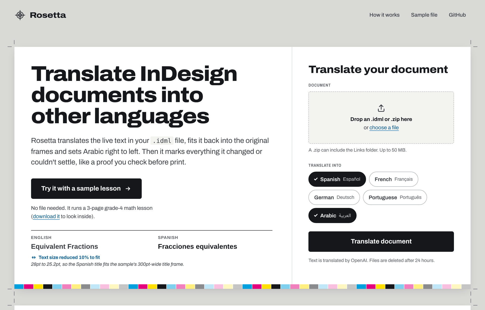
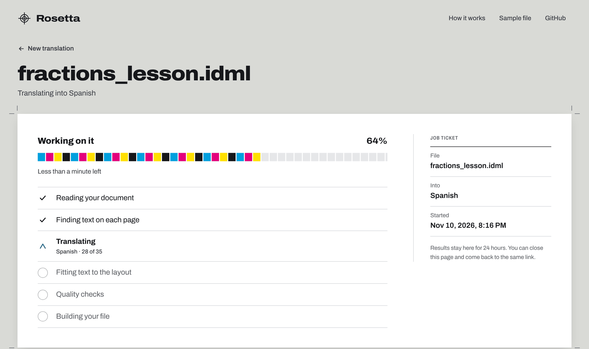
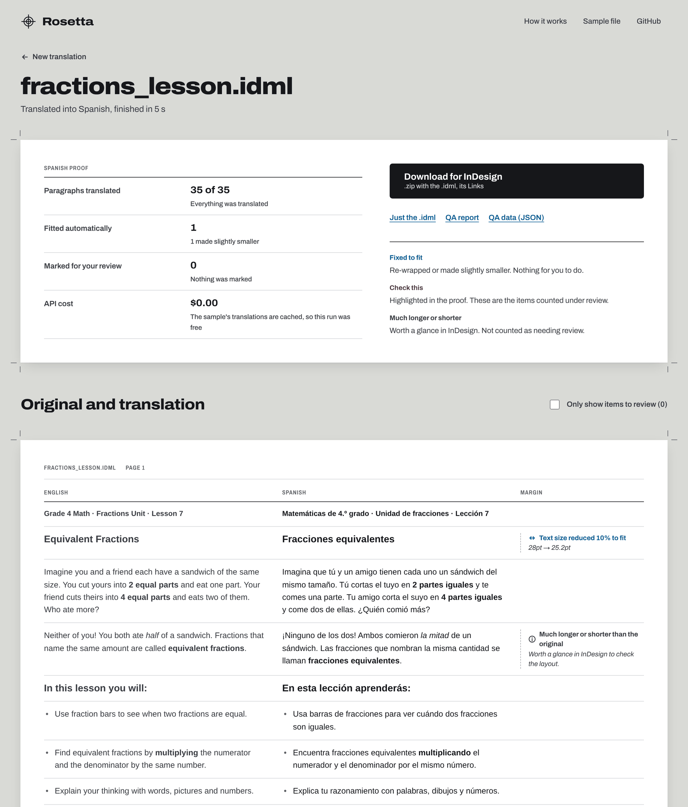

# Rosetta

**Translate Adobe InDesign documents into other languages, with the formatting, layout and right-to-left text taken care of.**

Upload an `.idml` file and get back a translated InDesign file you can open straight away, a side-by-side
preview to check in your browser, and a QA report listing anything that needs a human eye. Spanish, French,
German, Portuguese and Arabic are supported.

**Try it:** the live demo link will go here once public mode is switched on. Until then, run it locally in
two minutes (see [Quick start](#quick-start)) and click **Try it with a sample lesson**.



<table>
<tr>
<td width="50%"></td>
<td width="50%"></td>
</tr>
<tr>
<td>Live progress, step by step</td>
<td>Results: summary, downloads and the side-by-side proof (the sample lesson in Spanish)</td>
</tr>
</table>

## What it does

- **Keeps the formatting.** A sentence often spans several differently styled runs (a **bold** word, an
  *italic* phrase). Rosetta translates the whole sentence at once, with numbered tags around each run, so the
  grammar is right and the styling lands on the right words. Numbers and punctuation are never sent to the model.
- **Fits the layout.** Translations usually run 20-35% longer than English. Rosetta measures the translated
  text with real font metrics (HarfBuzz shaping) against each frame's real geometry from the IDML. When text
  doesn't fit, it re-wraps it, then tries a small, controlled font-size reduction, then asks the model for a
  shorter wording. If none of that works, it flags the text for a person instead of leaving a broken layout.
- **Handles right-to-left.** Arabic stories are flipped to right-to-left and set in Noto Sans Arabic, which is
  packaged with the output so it renders in InDesign without any setup.
- **Checks its own work.** The QA report lists anything untranslated, translated inconsistently, shortened to
  fit, or still too long, with the page it's on.
- **Shows you the result without InDesign.** The preview puts original and translation side by side, page by
  page, with bold/italic, tables and lists, and highlights what needs review.

## Quick start

Needs Python 3.11+ (developed on 3.13).

```bash
git clone https://github.com/ShravanKarthik6906/rosetta-translator.git
cd rosetta-translator
python3 -m venv .venv
source .venv/bin/activate            # Windows: .venv\Scripts\activate
pip install -r requirements.txt
cp .env.example .env                 # then put your OpenAI key in OPENAI_API_KEY
python app.py
```

Open <http://127.0.0.1:5050>. Click **Try it with a sample lesson**, or upload your own file.

**What to upload:** an `.idml` file (in InDesign, *File › Export… › InDesign Markup (IDML)*), or a `.zip`
containing one `.idml` and, optionally, its `Links` folder (an InDesign *Package* folder, zipped, works). The
Links folder is only needed if you want the images bundled with the result; text is translated either way.

The sample lesson is in [`samples/`](samples/). It's an original 3-page grade-4 lesson on equivalent fractions,
generated by [`samples/make_sample.py`](samples/make_sample.py). Download it from the app's home page to
inspect it.

### Running the tests

```bash
pip install -r requirements-dev.txt
pytest
```

The suite has 76 tests and needs no API key, because OpenAI is replaced by a local fake. It runs the
whole pipeline on the sample in all five languages and checks the output files. GitHub Actions runs it on
every push.

## Deploying

`render.yaml` deploys to [Render](https://render.com) as a single web service (gunicorn, **one** worker,
because jobs run in background threads of that worker). Set `OPENAI_API_KEY` in the Render dashboard, then choose a mode:

- **Private** (default): set `SITE_PASSWORD` and every visitor needs it (HTTP Basic Auth, any username).
- **Public demo**: set `PUBLIC_DEMO=true`. There's no password, and these limits switch on: a few documents per visitor per hour,
  a word limit per document, a cap on concurrent jobs, and a **daily spending cap**. When the cap is reached,
  uploads pause with a friendly message and the sample keeps working. Also set a hard monthly budget in the
  OpenAI dashboard; the in-app cap resets if the server's disk is wiped (see limitations).

The sample lesson is free to run: its real translations (gpt-5-mini, all five languages) are committed in
`samples/translation_cache.json`, and the app answers sample runs from that file, so no API key is needed for
the **Try it** button. If you change the sample or the translation prompts, rebuild the cache with
`python scripts/warm_sample_cache.py` (real, billed API calls; about $0.05-0.10 with gpt-5-mini) and commit it again.

### Settings

All settings are environment variables (or `.env`), documented in [`.env.example`](.env.example):

| Variable | Default | What it does |
|---|---|---|
| `OPENAI_API_KEY` | (none) | Required to translate your own files. |
| `ROSETTA_OPENAI_MODEL` | `gpt-4o` | Translation model (`gpt-5-mini` on Render). |
| `SITE_PASSWORD` | (none) | Private mode password. Ignored in public mode. |
| `PUBLIC_DEMO` | `false` | Open access with the limits below. |
| `DAILY_SPEND_CAP_USD` | `2` (public) | Max OpenAI spend per UTC day. |
| `RATE_LIMIT_JOBS_PER_HOUR` | `3` (public) | Uploads per visitor per hour. |
| `RATE_LIMIT_SAMPLES_PER_HOUR` | `20` (public) | Sample runs per visitor per hour. |
| `MAX_WORDS_PER_JOB` | `2500` (public) | Largest document accepted. |
| `MAX_CONCURRENT_JOBS` | `2` public / `4` | Jobs running at once. |
| `MAX_UPLOAD_MB` | `50` | Upload size limit. |
| `JOB_TTL_HOURS` | `24` | Files and results are deleted after this. |
| `OPENAI_TIMEOUT_SECONDS` / `OPENAI_MAX_RETRIES` | `90` / `3` | Per-request timeout and automatic retries. |
| `TRANSLATE_CONCURRENCY` | `4` | Paragraphs translated in parallel. |
| `ROSETTA_DATA_DIR` | `./webapp_jobs` | Where jobs and app state are stored. |

In private mode the limits default to off (`0`), but any of them can be set explicitly.

## Architecture

```
  .idml, or .zip with .idml + Links/
         |
         v
  [ web app: app.py ]  validate upload (uploads.py), start a background job (pipeline.py),
         |             persist job state (jobs.py), enforce demo limits (limits.py)
         v
  1. Read                 deconstruct.py      every <Content> fragment + style -> SQLite (rosetta.db)
  2. Find text on pages   story_placements.py map stories to pages/frames from Spreads XML
  3. Translate            translate.py        tagged whole-sentence translation      [OpenAI]
  4. Fit to the layout    overflow.py         measure (HarfBuzz + real frame geometry)
                          overflow_resolve.py   -> wrap -> shrink -> shorten         [OpenAI]
                                                -> flag for review
  5. Quality checks       exception_checks.py consistency / completeness / length
                          reports.py          HTML + JSON QA report per language
  6. Build the file       reconstruct.py      write translations into a copy of the IDML, flip RTL,
                                              apply script fonts, relative links, re-zip (+ package)
                          preview.py          side-by-side preview data for the browser
         |
         v
  translated .idml + InDesign package (.idml, Links, fonts) + QA report + preview
```

Supporting modules: `languages.py` (the single list of languages: names, direction, fonts), `llm.py`
(OpenAI client with timeouts and retries, the spending guard, the sample cache, plain-language error
messages), `config.py` (settings), `state.py` (app state database), `idml_check.py` (structural IDML
validator, also a CLI).

Every stage reads and writes the same `rosetta.db`, so each can also be run on its own from the command line:

```bash
mkdir idml_extracted && unzip YourFile.idml -d idml_extracted/
python deconstruct.py idml_extracted/ YourFile.idml rosetta.db
python story_placements.py rosetta.db 1 idml_extracted/
python translate.py rosetta.db 1 --dry-run                # no API calls
python translate.py rosetta.db 1 --langs=es,ar            # real, billed calls
python overflow_resolve.py rosetta.db 1 idml_extracted/ es,ar
python exception_checks.py rosetta.db 1 es,ar
python reconstruct.py rosetta.db 1 es idml_extracted/ idml_work_copy_es
python idml_check.py idml_work_copy_es/../YourFile_es.idml
```

`translate.py` also takes `--limit=N`, `--story-id=N` and `--paragraph-seq=N` to test on a few paragraphs.

### Adding a language

Add one entry to `LANGUAGES` in [`languages.py`](languages.py), then add a line of that language's special
characters to `tests/test_languages.py`, which checks that the bundled fonts cover them. Scripts the
document's own fonts can't show (as with Arabic) need a `font` and its files in `fonts/`.

### Customising the UI

The web UI is plain Jinja templates (`templates/`, all extending `base.html`), one stylesheet
(`static/styles.css`) and two small scripts (`static/upload.js`, `static/job.js`), with no build step.
Every colour, size and duration is a CSS custom property on `:root`, redefined for dark mode, so most
restyling means changing tokens. Fonts are self-hosted in `static/fonts/` (Archivo and Noto Sans Arabic,
SIL OFL). The app sends a strict Content-Security-Policy, so templates can't use inline `style` attributes
or inline scripts.

Restyle freely, but keep these hooks. The scripts and tests rely on them (`tests/test_ui_contract.py`
checks them):

- **Home (`index.html`)**: `#upload-form` (posts to `/upload`), `#document-input` (`name="document"`),
  `#dropzone`, `#dz-file`, `#document-error`, `#lang-chips` containing `input[name="langs"]` checkboxes,
  `#langs-error`, `#submit-button`, `#sample-button` (`name="sample" value="1"`, `form="upload-form"`),
  `#upload-progress`, `#upload-bar`, `#upload-status`, and `data-max-bytes` on the `upload.js` script tag.
  `#server-error` appears when the server re-renders the page with an error.
- **Job page (`job.html`)**: `#job` with `data-job-id`, `#job-sub`, `#notices`, `#status-sheet`,
  `#progress-card`, `#progress-title`, `#progress-pct`, `#progress-bar`, `#progress-fill`, `#eta`,
  `#checklist`, `#wake-note`, `#error-card`, `#error-title`, `#error-message`, `#ticket-started`,
  `#results`, `#lang-tabs`, `#lang-panels`, `#tech`, `#tech-meta`, `#log`.
- **API fields `job.js` reads** (`GET /api/job/<id>`): `status`, `progress`, `eta_seconds`,
  `steps[].key/label/state/detail`, `langs`, `languages{}.name/native/rtl/state/error`, `notices[]`,
  `error.code/title/message/detail`, `results{}.summary/downloads/package_name/idml_name`, `usage`,
  `cost`, `log`, `source_name`, `is_sample`, `created_at`, `started_at`, `finished_at`. The preview comes
  from `GET /api/job/<id>/preview` (`pages[].stories[].blocks[]`, `langs{}.texts/flags/summary`).

## Known limitations

An honest list. Please read it before relying on Rosetta for anything important.

- **Translations are machine-generated.** The QA report checks completeness, consistency and fit, not
  linguistic quality. Have a fluent speaker review before publishing.
- **Your text goes to OpenAI.** Don't upload confidential documents unless that's acceptable to you.
- **Tested on a limited set of documents.** It has been tested end to end on one real production document
  and the bundled sample. Unusual InDesign features (anchored objects, footnotes, text on paths, complex nested
  tables) may not be handled. Story placement covers frames placed on spreads; text that only lives on master
  pages (running heads, footers) is translated but not measured for fit.
- **Fit is measured per text fragment, with substitute fonts.** Licensed commercial fonts usually aren't
  available on the server, so Latin text is measured with metric-similar open fonts (exact for Arial, close
  for others). InDesign's own line breaking can still differ slightly, so check the flagged items.
- **Some overflow can't be fixed automatically.** It's flagged in the preview and the QA report for you to
  resize the frame. Shortened-to-fit wording is always flagged for review because it changes the text.
- **Arabic and Latin digits.** Noto Sans Arabic has no Latin letters or Western digits. Arabic runs that
  contain them may show missing glyphs in InDesign until you apply a font that has both. Paragraph-level
  direction and table direction aren't flipped, only story direction.
- **The public demo's daily spending cap is stored on the server's local disk.** On hosts with ephemeral disks
  (like Render's free tier) it resets when the server restarts, so the hard monthly limit in the OpenAI
  dashboard is the real backstop.
- **Jobs run inside the web process.** A restart interrupts running jobs (they're shown as interrupted, not
  lost), and the app must run with a single worker.
- **The prompt assumes educational material.** It describes the text as a K-12 math worksheet, which suits
  the documents Rosetta was built for. Other kinds of documents still translate well, but the prompt could
  be made configurable.

## License

[MIT](LICENSE). Bundled fonts are licensed separately under the SIL Open Font License (see `fonts/`).
